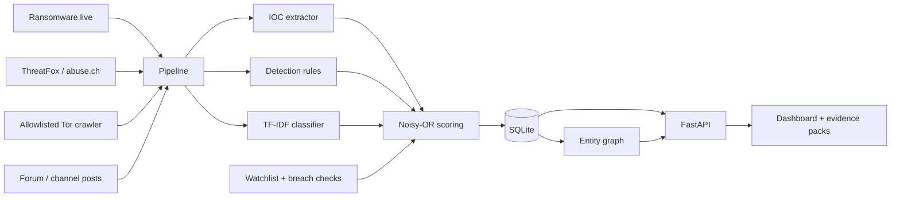

# DarkLens

**Multi-layered dark web analysis, credential breach detection and proactive cyber threat intelligence.**

DarkLens collects threat chatter and indicators from legal feeds (and an allowlisted Tor crawler), classifies it, extracts indicators, checks your watched domains for leaked credentials, links actors through shared payment addresses, and turns it all into scored, explainable alerts on a dashboard.

> Built as a Samsung Innovation Campus capstone (Batch A5). Defensive research only, see [SECURITY.md](SECURITY.md).

## Try it in 60 seconds (no API keys, no network)

```bash
pip install -r requirements.txt
python -m darklens serve          # loads the offline demo data, then open http://127.0.0.1:8000
```

1. Click the top alert to see **why** it scored what it did, signal by signal.
2. In the Watchlist box add `granite-bank.example`. Everything is re-scored and the credential dump aimed at that domain jumps to 100.
3. Look at the entity graph: two forum personas share one Bitcoin address, flagged as a possible single operator.
4. Open the **evidence pack** for any alert: a self-contained HTML file sealed with a SHA-256 hash.

The page served at `/` is the original single-file dashboard. There is also a newer React app in [`frontend/`](frontend) with plain-language labels, a severity-coloured connection map and a "Check a post" tool; see [Web app](#web-app-frontend) below.

## What makes it different

| Feature | How it works |
| --- | --- |
| **Explainable scores** | Every alert is a set of signals combined with noisy-OR, `1 - prod(1 - s/100)`. Weak signals add up, a strong one dominates. Generic content signals are discounted so only converging evidence reaches critical. |
| **Hybrid classifier** | 23 original MIT-licensed detection rules fused with a TF-IDF + logistic regression model over 8 categories. |
| **Honest evaluation** | Tested on held-out sentence structures the model never saw, not just held-out rows. |
| **Watchlist-aware** | Watched domains and emails turn generic intel into "this is about us" and are the strongest signal. |
| **Validated IOCs** | Bitcoin and Tron addresses pass Base58Check, private IPs and file names are dropped, defanged indicators (`hxxp`, `[.]`) are restored. |
| **Actor linking** | Personas that share a wallet or indicator are linked, the same idea as co-spend clustering in blockchain forensics. |
| **Campaign correlation** | Alerts linked through shared wallets or indicators are grouped, and risk spreads with Personalized PageRank. Same-handle posts are not counted as a campaign. |
| **ATT&CK mapping** | Every alert lists the MITRE ATT&CK techniques its category points to. |
| **Observed vs inferred** | Evidence packs separate what was observed, what was inferred, and what was not checked. Unknown is never reported as safe. |
| **Privacy by design** | Passwords are masked before storage, password checks use k-anonymity, crawler is allowlisted and read-only. |
| **Offline demo mode** | Every collector has a synthetic snapshot, so the demo never depends on a feed, key or Tor circuit. |

## Architecture



## Evaluation

Macro-F1 on 350 held-out synthetic samples built from sentence structures not used for training:

| Predictor | Macro-F1 |
| --- | --- |
| Rules only | 0.771 |
| TF-IDF + logistic regression only | 0.547 |
| **Hybrid (default)** | **0.836** |

Reproduce with `python -m darklens eval`. Per-class results are printed, and the weakest class (threat chatter) is the honest limitation to work on next.

## Project layout

```
darklens/
  collectors/   ransomware_live, threatfox, forums (live + offline snapshots)
  crawler/      allowlisted read-only Tor crawler
  extract/      validated IOC extraction
  rules/        rules.yaml (23 original rules) and the engine
  nlp/          synthetic corpus, hybrid classifier, evaluation
  breach/       Pwned Passwords k-anonymity, combolist masking, watchlist exposure
  graph/        entity graph and actor linking
  store/        SQLite
  api/          FastAPI backend
  evidence.py   SHA-256 sealed evidence packs
dashboard/      original single-page dashboard (served by the API at /)
frontend/       React + TypeScript web app (Vite), deployed separately
tests/          pytest suite
```

## Web app (frontend)

A React 18 + TypeScript + Vite app in `frontend/` that talks to the API over HTTP. Pages: Overview, Alerts, a full alert report (score ring, reasons, clues, ATT&CK techniques), Connections (entity graph, shared-operator hints, campaigns), Watchlist, Check a post, and How it works (including the model's own test scores). Labels are in plain words and every page works at phone width.

```bash
# terminal 1: the API
python -m darklens serve
# terminal 2: the web app (proxies /api to port 8000, so no CORS setup is needed)
cd frontend
npm install
npm run dev        # http://localhost:5173
npm test           # unit tests for the helpers and routing
npm run lint && npm run build
```

**Deploying it separately** (for example the app on Vercel and the API on Render):

| Where | Setting | Value |
| --- | --- | --- |
| Vercel project | Root directory | `frontend` |
| Vercel project | `VITE_API_URL` | the API address, no trailing slash |
| API host | `ALLOWED_ORIGINS` | the web app address(es), comma separated, no trailing slash |

`ALLOWED_ORIGINS` is off by default, so the API stays same-origin only until you set it. The app uses hash routes (`#/alerts`), so no rewrite rules are needed.

## Live data (optional)

```bash
export ABUSECH_AUTH_KEY=...        # free key from https://auth.abuse.ch/
python -m darklens ingest --live   # Ransomware.live + ThreatFox
```

Ransomware.live data requires attribution and non-commercial use. The base URL is configurable via `RANSOMWARE_LIVE_BASE`.

## API

`GET /api/stats` `GET /api/alerts` `GET /api/alerts/{id}` `GET /api/alerts/{id}/evidence` `GET /api/graph` (includes campaigns) `GET|POST /api/watchlist` `POST /api/ingest` `POST /api/analyse` `GET /api/eval` `GET|HEAD /api/health`. Interactive docs at `/docs`.

## Honest limitations

- The training corpus is **synthetic**, so F1 shows the method works, not how it performs on real forum text. Real labelled data is the next step.
- Actor linking by shared wallets is a heuristic, not proof. Shared infrastructure or a shared tutorial can create false links.
- Rule weights are hand-tuned and the severity thresholds are not calibrated on real incidents.
- Rules look for specific patterns (for example `email:password` lines for stolen logins), so a short post that only says a database is for sale can score lower than it deserves.
- The database is a local SQLite file. On a free host that restarts, it resets to the demo data.
- Per-email breach search needs a paid HIBP key and is not enabled by default.
- The Tor crawler is intentionally minimal and its allowlist ships empty.
- No authentication on the API. Run it locally or behind your own access control.

## Roadmap

DistilBERT fine-tune and comparison, URLhaus and OTX feeds, Postgres, alert export (STIX 2.1), Docker image, analyst feedback loop to retrain.

## Team

Bhavit Anand, Krish Anand, Prateek Tanwar, Sahil Prasad, Naisha Kohli.

## Licence

MIT. See [LICENSE](LICENSE).
