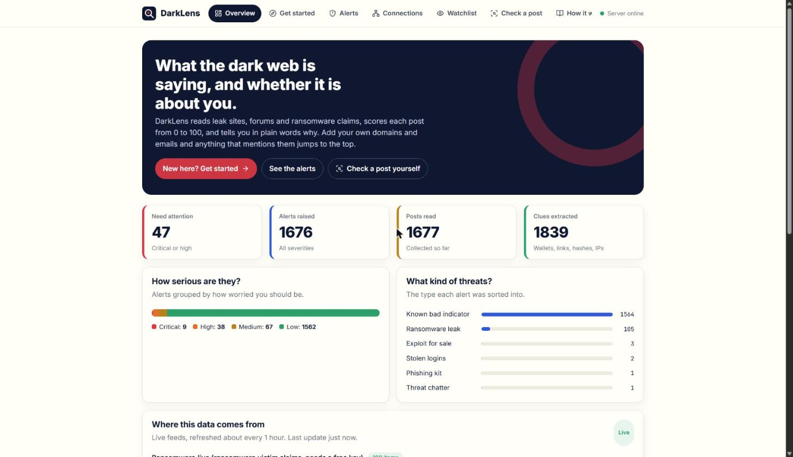
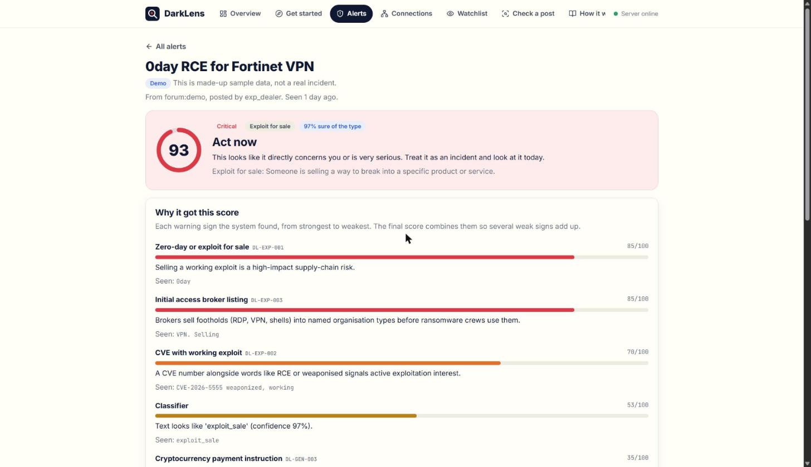
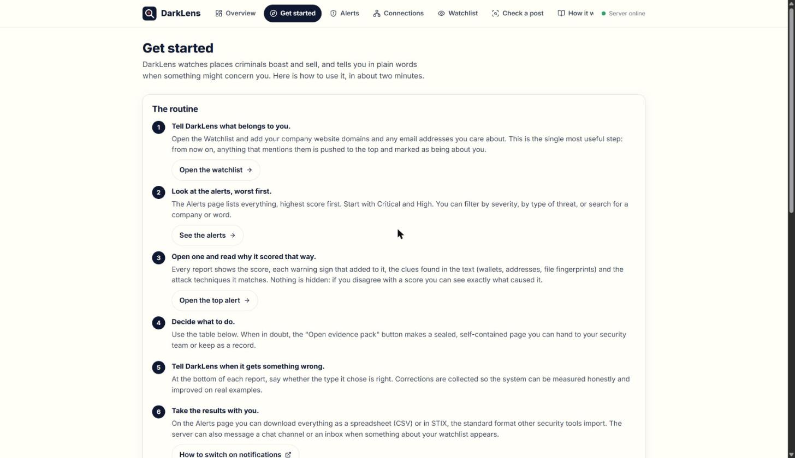
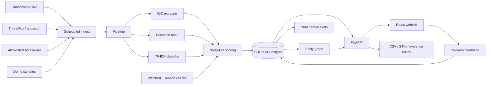

# DarkLens

[](https://github.com/bhavitanand/darkweb-threat-intel-capstone/actions/workflows/ci.yml)
[](LICENSE)

**Multi-layered dark web analysis, credential breach detection and proactive cyber threat intelligence, explained in plain English.**

**Live site: <https://darklens-seven.vercel.app>** · API docs: <https://darklens-capstone.onrender.com/docs> · [Documentation](#documentation)

DarkLens watches public sources where criminals boast, sell and extort (today: live ransomware victim claims, malicious indicators and links, and the vulnerabilities CISA says are being exploited), scores every item from 0 to 100, and tells you **why** in plain words. Add your own domains and emails and anything that mentions them jumps to the top. It can also message you when that happens.

**Current version: 0.3.0** (23 Nov 2026). Every release is listed in the [changelog](CHANGELOG.md), with a git tag per version.

> Built as a Samsung Innovation Campus capstone (Batch A5). Defensive research only, see [SECURITY.md](SECURITY.md).



<table>
  <tr>
    <td width="50%"><br><sub>An alert report. This one is a made-up demo alert: the score, the verdict in plain words, and each reason with its strength.</sub></td>
    <td width="50%"><br><sub>The built-in Get started page walks a new person through the routine.</sub></td>
  </tr>
</table>

## Using the website

The site has a built-in **Get started** page. In short:

1. **Watchlist**: add your company's domains and emails. (The watchlist is shared by every visitor, since there are no accounts yet. Run your own copy for private monitoring.)
2. **Alerts**: work from the top, Critical then High. Filter by type, or by real versus demo data.
3. **Open an alert**: read the score, every reason behind it, the clues found, and the attack techniques it matches.
4. **Decide**: Critical means act now, High means review within a day, Medium means keep an eye on it, Low needs nothing.
5. **"Is this right?"**: tell DarkLens when it got the type wrong. This is how accuracy on real data is measured.
6. **Take it with you**: export CSV or STIX 2.1, open a sealed evidence pack, or switch on chat and email alerts.

Alerts marked **Demo** are made up so the tool is never empty. The full walkthrough, with the data flow, is in [docs/workflow.md](docs/workflow.md).

## Run it yourself in 60 seconds (no accounts, no keys)

```bash
pip install -r requirements.txt
python -m darklens serve                    # API and original dashboard on http://127.0.0.1:8000
cd frontend && npm install && npm run dev   # website on http://localhost:5173 (proxies /api)
```

Try it: open the top alert and read why it scored what it did. Add `granite-bank.example` to the watchlist and watch the credential dump aimed at that domain jump to 100. Look at the connection map: two forum personas share one Bitcoin address, flagged as a possible single operator.

Collect real data with `python -m darklens ingest --live`, after getting a free [Ransomware.live key](https://my.ransomware.live) (`RANSOMWARE_LIVE_API_KEY`, required by their terms) and optionally a free [abuse.ch key](https://auth.abuse.ch/) (`ABUSECH_AUTH_KEY`). A source without its key is skipped. Hosting it for others is covered in [docs/deployment.md](docs/deployment.md).

## What makes it different

| Feature | How it works |
| --- | --- |
| **Explainable scores** | Every alert is a set of signals combined with noisy-OR, `1 - prod(1 - s/100)`. Weak signals add up, a strong one dominates. Generic signals are discounted so only converging evidence reaches critical. |
| **Hybrid classifier** | 27 original MIT-licensed detection rules fused with a TF-IDF + logistic regression model over 8 categories, with a "Not sure" answer instead of a guess when the model alone is unsure. |
| **Honest evaluation** | Synthetic held-out templates, **plus** checks on real claims, reviewer feedback and your own labelled data. The page [docs/accuracy.md](docs/accuracy.md) says what is and is not measured. |
| **Watchlist-aware** | Watched domains, emails and **software or vendor names** turn generic intel into "this is about us". An attack on a product you run, or a CISA-listed exploited flaw in it, becomes High; a patch story is Medium. Adding an entry re-scores the stored items that mention it. |
| **Live and demo data, clearly separated** | Real feeds on a schedule with per-source status; synthetic samples carry a Demo badge and never trigger notifications. |
| **Validated IOCs** | Bitcoin and Tron addresses pass Base58Check, private IPs and file names are dropped, defanged indicators (`hxxp`, `[.]`) are restored. |
| **Actor linking and campaigns** | Personas that share a wallet or indicator are linked; alerts connected through shared indicators are grouped, with risk spread by Personalized PageRank. |
| **ATT&CK mapping** | Every alert lists the MITRE ATT&CK techniques its category points to. |
| **Observed vs inferred** | Evidence packs separate what was observed, what was inferred, and what was not checked. Unknown is never reported as safe. |
| **Privacy by design** | Passwords are masked before storage, password checks use k-anonymity, the crawler is allowlisted and read-only. |
| **Private workspaces** | Sign in with an emailed one-time link (no passwords). Keep a private watchlist, see only alerts about it, get a daily or weekly digest and a Slack, Discord or Teams alert, and use read-only API keys. See [docs/threat-model.md](docs/threat-model.md). |
| **Integrations** | CSV, STIX 2.1 and MISP export, a read-only TAXII 2.1 server, Slack/Discord/Teams webhook and email notifications, indicator lookups through OTX, VirusTotal and GreyNoise (when their free keys are set). Sources whose terms forbid re-publishing (Ransomware.live) are credited with a link, shown without their raw text, and left out of exports. |

## Architecture



## Accuracy, honestly

| Measured on | Result |
| --- | --- |
| 350 synthetic held-out samples | Hybrid macro-F1 **0.836** (rules 0.771, model 0.547). Shows the method works, not real-world performance. |
| 100 real Ransomware.live claims (16 Nov 2026) | First version scored 90% of them Low. Found by testing on real data and fixed: now all recognised, 68 Medium and 32 High. |
| 234 real ordinary news items (16 Nov 2026) | False alarms fell from 32% to **2.6%** (Medium or higher: 3.0% to 0.9%) after fixing three over-eager rules and the "Not sure" cut, with 11 of 12 real threats still detected. **Provisional:** labels are from four independent AI labellers (kappa 0.85), not humans, and the same items were used to find the problems. [Details and caveats](docs/accuracy.md#5-measured-on-real-public-text-16-november-2026) |
| 177 **untouched** real items (17 Nov 2026, scored once before any change) | **0 false alarms on 113 ordinary items**, but **3 of 9 real breach reports were missed** (worded "data exposed", "impacted by a breach"). The rule was fixed afterwards, so that set is spent; with 9 threats this is a warning, not a rate. [Details](docs/accuracy.md#the-untouched-test-17-november-2026) |
| **1,033 real breaches and 1,043 real advisories** (public data, trained before 2026, tested on 117 breaches and 203 advisories never seen) | **100% of unseen breaches detected and correctly typed** (from 36%), and **0% false alarms on unseen advisories** (from 9.9%). Real text, free sources, reproducible with `python -m darklens eval --real` and enforced in CI. The breach figure is flattered by their shared style, and the model was tuned using the news sets: [read the caveats](docs/accuracy.md#trained-and-measured-on-real-data-17-november-second-round). |
| Exploit sale, malware sale, card fraud, threat chatter on real text | **Not measured.** Public news contains no examples; it needs real underground-style text. |
| Real forum and market posts | **Not measured yet.** This is the top item on the [roadmap](docs/roadmap.md). |

Details, known weaknesses and how to contribute labels: [docs/accuracy.md](docs/accuracy.md). Reproduce with `python -m darklens eval` (also `--live-claims`, `--feedback`, `--csv FILE`).

## Documentation

| Page | What is in it |
| --- | --- |
| [docs/workflow.md](docs/workflow.md) | The data flow and what you are meant to do in the website |
| [docs/deployment.md](docs/deployment.md) | Vercel + Render + Neon, every environment variable, keeping the free API awake |
| [docs/data-sources.md](docs/data-sources.md) | Sources and their terms, what is stored and what never is, retention |
| [docs/alerts-and-notifications.md](docs/alerts-and-notifications.md) | Chat and email alerts, exports |
| [docs/accuracy.md](docs/accuracy.md) | What has been measured, weaknesses, how to measure properly |
| [docs/labelling.md](docs/labelling.md) | How to build the real labelled set that will measure accuracy on real text |
| [docs/api.md](docs/api.md) | Every endpoint |
| [docs/roadmap.md](docs/roadmap.md) | Versions, what is done, what needs a person, what 1.0 means |
| [docs/threat-model.md](docs/threat-model.md) | What is protected, who might attack, and the known limits |
| [CHANGELOG.md](CHANGELOG.md), [CONTRIBUTING.md](CONTRIBUTING.md), [SECURITY.md](SECURITY.md) | Changes, how to contribute, ethics and responsible use |

## Project layout

```
darklens/
  collectors/   ransomware_live, threatfox, forums (live + offline snapshots)
  crawler/      allowlisted read-only Tor crawler (disabled by default)
  extract/      validated IOC extraction
  rules/        rules.yaml (27 original rules) and the engine
  nlp/          synthetic corpus, hybrid classifier, evaluation (synthetic, real claims, feedback, CSV)
  breach/       Pwned Passwords k-anonymity, combolist masking, watchlist exposure
  graph/        entity graph and actor linking
  store/        SQLite or Postgres behind one interface
  api/          FastAPI backend and rate limiter
  ingest.py     scheduled collection with per-source status
  notify.py     webhook and email alerts
  export.py     CSV and STIX 2.1
  evidence.py   SHA-256 sealed evidence packs
dashboard/      original single-page dashboard (served by the API at /)
frontend/       React + TypeScript website (Vite)
docs/           documentation
data/           demo samples, and a place for real labelled examples
tests/          pytest suite (runs in CI)
tests_real/     the same product on real collected text and the live site (local; needs the private labelling data)
```

## Tests

```bash
pip install -r requirements-dev.txt
python -m pytest -q                         # backend; set TEST_DATABASE_URL to also run against Postgres
cd frontend && npm ci && npm run lint && npm test && npm run build
```

CI runs both on every push, with a real Postgres service for the storage and API tests.

**On real data, not only synthetic:** `python -m pytest tests_real -q` runs every component on the collected real items (robustness, determinism, speed, indicator extraction, masking, the whole API, exports, the hidden-text guarantee) and enforces accuracy floors on the labelled real sets; `tests_real/test_live_site.py` smoke-tests the deployed site on its live feeds. The real text is private and git-ignored, so these are skipped on a fresh clone and are not part of CI.

## Honest limitations

- The training corpus is **synthetic**. Accuracy on real forum text is unmeasured, and the model sometimes gives ordinary text a ransomware label at a low score (see [docs/accuracy.md](docs/accuracy.md)).
- Rules are keyword patterns, so unusual wording can slip past them. Rule weights are hand-tuned and severity thresholds are not calibrated on real incidents.
- Actor linking by shared wallets is a heuristic, not proof.
- **Accounts are email-only.** Sign-in is a one-time link to an inbox, with no second factor. The public feed and the shared public watchlist are open to everyone (rate limited); private lists belong in a workspace.
- A claim on Ransomware.live is an accusation by criminals, not a confirmed breach.
- Without `DATABASE_URL`, data lives in a local SQLite file that resets when a free host restarts.
- Per-email breach search needs a paid HIBP key and is not enabled by default.
- The Tor crawler is intentionally minimal, its allowlist ships empty, and it is off by default.

## Roadmap

See [docs/roadmap.md](docs/roadmap.md): what is done, what needs a person (a free Neon database, labelled data, webhooks), and what is next.

## Team

[Bhavit Anand](https://github.com/bhavitanand), [Krish Anand](https://github.com/Krish-Anand-dev), [Prateek Tanwar](https://github.com/prateektanwar373), [Sahil Prasad](https://github.com/sahil-prasad), [Naisha Kohli](https://github.com/naisha-kohli). See [CONTRIBUTORS.md](CONTRIBUTORS.md).

## Data credits

Breach descriptions used for training and testing come from [Have I Been Pwned](https://haveibeenpwned.com) (Troy Hunt), licensed [CC BY 4.0](https://creativecommons.org/licenses/by/4.0/). Vulnerability descriptions come from the [NIST National Vulnerability Database](https://nvd.nist.gov) (public domain). Ransomware claims: [Ransomware.live](https://www.ransomware.live). Indicators: [abuse.ch](https://abuse.ch). Exploited vulnerabilities: [CISA KEV](https://www.cisa.gov/known-exploited-vulnerabilities-catalog). Details in [data/real_labelled/README.md](data/real_labelled/README.md) and [docs/data-sources.md](docs/data-sources.md).

## Licence

MIT. See [LICENSE](LICENSE). Live ransomware claims: source [Ransomware.live](https://www.ransomware.live), used under its [terms](https://www.ransomware.live/t&c) (non-commercial, attribution, no re-publishing of raw data).
