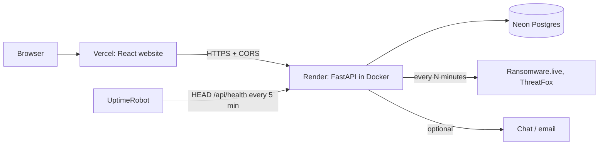

# Deploying DarkLens

The reference setup is all free-tier: the website on **Vercel**, the API on **Render**, the database on **Neon** (Postgres), and **UptimeRobot** to keep the free API awake. Everything also runs locally with no accounts at all.



## 1. Run it locally (no accounts)

```bash
pip install -r requirements.txt
python -m darklens serve                  # API + original dashboard on http://127.0.0.1:8000
cd frontend && npm install && npm run dev # website on http://localhost:5173 (proxies /api)
```

Storage is a local SQLite file. Nothing else is needed.

## 2. The API on Render

1. New **Web Service** from the GitHub repo, **Docker** runtime, root directory the repo root. The `Dockerfile` is already there.
2. Health check path: `/api/health`.
3. Set environment variables (below), then deploy.

## 3. The website on Vercel

1. Import the same repo, set **Root Directory** to `frontend` (Vite is detected).
2. Add `VITE_API_URL` = the Render address, no trailing slash. Leave **Sensitive** off (it is a public address, and the build has to read it).
3. Deploy. Routes use hash URLs (`#/alerts`), so no rewrite rules are needed.
4. Copy the Vercel address into Render's `ALLOWED_ORIGINS` and redeploy the API.

## 4. A database that survives restarts (Neon)

Free hosts restart and wipe local files, which would reset your watchlist and collected data.

1. Create a free project at <https://neon.tech> and copy the **connection string** (use the pooled one, it ends in `?sslmode=require`).
2. Set `DATABASE_URL` on Render to that string. On the next start the tables are created automatically, and `/api/health` reports `"storage": "postgres"`.
3. Keep this string secret: it is a password.

If `DATABASE_URL` is unset, the API uses SQLite (fine locally, resets on a free host).

## 5. Keep the free API awake

Render's free tier sleeps after 15 minutes without traffic. Add an UptimeRobot **HTTP(s)** monitor on `https://<api>/api/health` every 5 minutes. The route answers `HEAD`, which is what UptimeRobot sends on its free plan.

## Environment variables

| Variable | Where | Purpose | Default |
| --- | --- | --- | --- |
| `VITE_API_URL` | Vercel | API address the website calls | empty (uses same origin / dev proxy) |
| `ALLOWED_ORIGINS` | Render | Website addresses allowed to call the API, comma separated, no trailing slash | none (same-origin only) |
| `DATABASE_URL` | Render | Postgres connection string | SQLite file |
| `DARKLENS_DB` | any | SQLite file path | `darklens.db` |
| `AUTO_INGEST_MINUTES` | Render | Collect live data this often (minimum 30). `0` = off | `0` |
| `RETENTION_DAYS` | Render | Delete real claims and posts older than this. `0` = keep | `90` |
| `FEED_RETENTION_DAYS` | Render | Delete indicator-feed entries (ThreatFox, URLhaus) older than this. `0` = keep | `14` |
| `RANSOMWARE_LIVE_API_KEY` | Render | Enables live Ransomware.live claims. Free key from <https://my.ransomware.live>. Required by their terms | unset (skipped) |
| `ABUSECH_AUTH_KEY` | Render | Enables ThreatFox. Free key from <https://auth.abuse.ch/> | unset (skipped) |
| `INGEST_TOKEN` | Render | If set, `POST /api/ingest` needs header `X-Ingest-Token`. Without it, live collection through the API is refused (scheduled collection is unaffected) | unset |
| `RATE_LIMIT_PER_MIN` | Render | Reads per client per minute. `0` = off | `120` |
| `RATE_LIMIT_WRITE_PER_MIN` | Render | Writes per client per minute. `0` = off | `20` |
| `TRUST_PROXY` | Render | `1` = take the client address from `X-Forwarded-For` (set on Render) | off |
| `ALERT_WEBHOOK_URL`, `SMTP_*`, `ALERT_EMAIL_TO`, `NOTIFY_MIN`, `PUBLIC_APP_URL` | Render | See [alerts and notifications](alerts-and-notifications.md) | off |
| `BREVO_API_KEY` or `SMTP_HOST`, `SMTP_PORT`, `SMTP_USER`, `SMTP_PASSWORD`, plus `MAIL_FROM` | Render | Sends sign-in links and digests. Without one, sign-in cannot email (set `AUTH_DEV_LINKS=1` locally to get the link in the response) | unset |
| `AUTH_DEV_LINKS` | local only | `1` returns the sign-in link in the response. Never set on a public server | off |
| `SENTRY_DSN` | Render | Optional error reporting (`sentry-sdk` is in requirements.txt). No request bodies or user text are sent | off |
| `VOTER_SALT` | Render | Salt for anonymous feedback votes | built-in |

Never commit values for keys, tokens, webhook URLs or `DATABASE_URL`. Set them in the host's dashboard.

## Updating

Pushing to `main` redeploys both hosts automatically. CI (see `.github/workflows/ci.yml`) runs the backend tests (including against a real Postgres) and the frontend lint, tests and build on every push.

## Known limits of the free setup

- The API cold-starts in up to a minute if the monitor is down. The website tells visitors when it is waiting.
- Rate limiting is per process. If you ever run several API instances, move it to a gateway.
- The shared Postgres connection is one per process, which suits a single worker.
