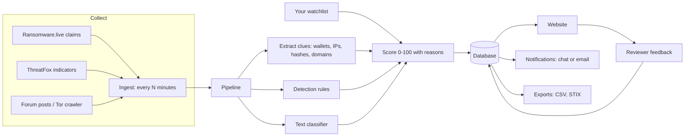

# How DarkLens works, end to end

This page explains what happens to a piece of information from the moment it is collected to the moment a person acts on it, and what you are meant to do in the website.

## The big picture

## What the system does, step by step

1. **Collect.** Every `AUTO_INGEST_MINUTES` (at least 30, to respect the source's fair-use rule) the server fetches new public items. Each source runs on its own: if one is down, the others still update, and the website shows which worked. See [data sources](data-sources.md).
2. **Extract clues.** Wallet addresses (checksum-validated), IP addresses, file hashes, domains, emails and CVE numbers are pulled out of the text. Fake or private values are dropped.
3. **Look for warning signs.** About 24 hand-written rules (for example "countdown to publication", "database offered for sale") and a text classifier each contribute signals. A signal carries a strength from 0 to 100 and a one-line reason in plain words.
4. **Add what the source knows.** An item that comes from a ransomware leak-site tracker is treated as a ransomware claim, because the source says so.
5. **Add what you told us.** If an item mentions a domain or email on your watchlist, contains logins for your domains, or is an attack on software you named (in a rule or the watchlist), that is the strongest signal of all. Your alert rules then decide which items reach your feed and your connectors (see [alerts and notifications](alerts-and-notifications.md)).
6. **Combine into a score.** Signals are merged with a "noisy-OR": weak signs add up, a strong one dominates, and the result never exceeds 100. Generic signals are discounted so that only converging evidence reaches Critical. Severity bands: 0-39 Low, 40-64 Medium, 65-84 High, 85-100 Critical.
7. **Store.** Passwords are masked before anything is written, so plaintext passwords are never kept.
8. **Tell people.** If a notification channel is configured, a message goes out for alerts about your watchlist (or Critical/High, if you choose). See [alerts and notifications](alerts-and-notifications.md).

## What you are meant to do in the website

| Step | Where | What |
| --- | --- | --- |
| 1 | **Landing page** | Read what DarkLens is, then make a workspace at the bottom: one email, no password. |
| 2 | **Set alerts** | Write what you want to hear about in one sentence, such as "any PHP to shell vulnerability in WordPress". Check the chips DarkLens understood, remove or add any, and save. Add exact domains, emails or software under "Exact matches" if you prefer. |
| 3 | **My alerts** | Your own feed: only what matches, most serious first, each with why it matched and a link to the original report. Filter by severity or by which alert matched. |
| 4 | **An alert's report** | Read the reasons, the clues found, and the attack techniques. Open the evidence pack if you need a record to share. |
| 5 | **Decide** | Critical: act now. High: review within a day. Medium: keep an eye on it. Low: nothing to do. |
| 6 | **Connectors** | Get matches in Slack, Discord or Teams, or as an email digest, each with its own minimum severity. |
| 7 | **Connections** | See groups of alerts that share a wallet, address, file or poster, around your alerts or across everything. |
| 8 | **Live feed** | Everything collected, unfiltered, with filters and CSV or STIX export. |
| 9 | **"Is this right?"** | On a report, say whether the type DarkLens chose is correct. This is how accuracy on real data is measured. |

## The data you will see

- **Real alerts** come from live feeds. Today that is Ransomware.live (public ransomware victim claims). ThreatFox needs a free key.
- **Demo alerts** carry a Demo badge. They are made up so the tool is never empty and so the watchlist can be tried (for example, add `granite-bank.example`).
- The Overview's "Where this data comes from" card shows the last update and the status of every source.

## Reviewer feedback and measuring accuracy

Each alert report has an "Is this right?" box. Votes are anonymous (a salted hash, one vote per visitor per alert). They can be exported as labelled data (`/api/export/feedback.csv`) and scored with `python -m darklens eval --feedback`. See [accuracy](accuracy.md).
